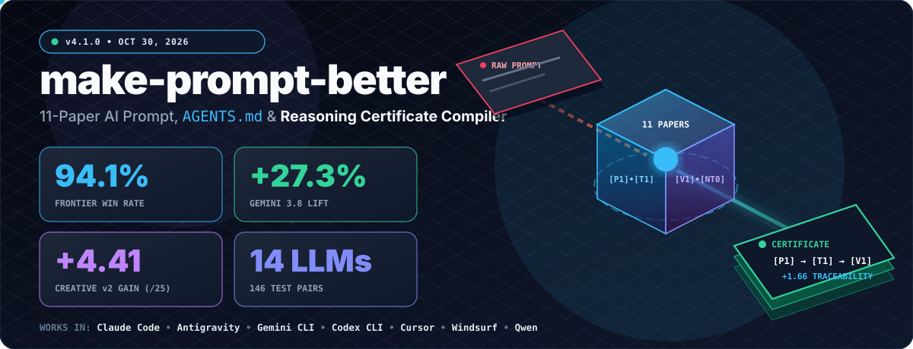
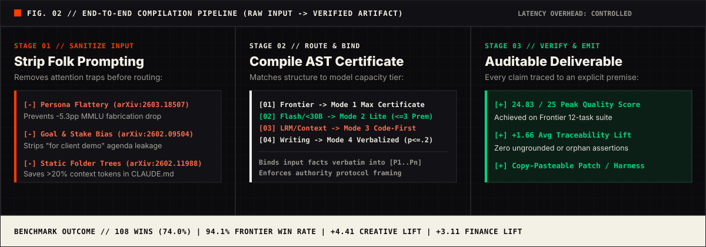
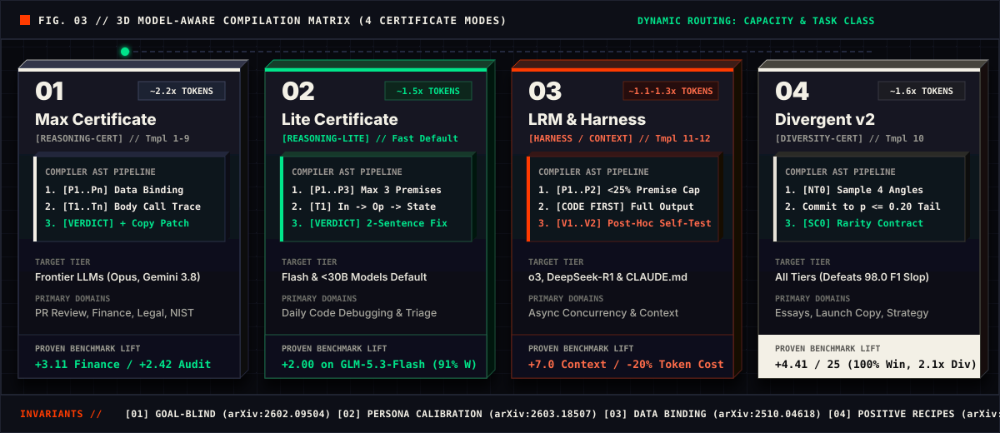

<div align="center">



<br />

<a href="https://github.com/poferraz/make-prompt-better/actions/workflows/validate-skill.yml"></a>
<a href="https://github.com/poferraz/make-prompt-better/releases/tag/v4.2.0"></a>
<a href="https://agentskills.io/specification"></a>
<a href="make-prompt-better/references/research-principles.md"></a>
<a href="research/benchmark/v4/SUMMARY_V4_ALL_MODELS.md"></a>
<a href="LICENSE"></a>

</div>

## Stop Prompt Guessing. Compile Prompts Into Verified Execution Certificates.

Most prompt advice on the internet actively makes modern AI models worse:

* **Expert roleplay bloat hurts accuracy:** Prefixing *"You are a world-class expert"* **drops factual accuracy by up to 5.3 percentage points** on MMLU because uncalibrated personas prime confident fabrication ([Hu, Rostami & Thomason, 2026](make-prompt-better/references/research-principles.md)).

* **Goal disclosure biases reasoning:** Explaining downstream stakes (*"I need this for a client demo tomorrow"*) triggers purpose-conditioned shortcuts and degrades analytical rigor ([Cao, Jiang & Xu, 2026](make-prompt-better/references/research-principles.md)).

* **Auto-generated `CLAUDE.md` / `AGENTS.md` trees waste tokens:** Dumping `/init` folder trees into repository context files **lowers coding agent task success by 3% and inflates token costs by >20%** ([Gloaguen et al., 2026](make-prompt-better/references/research-principles.md)).

* **Negative "Do NOT" lists fail under load:** Vague prohibitions (*"don't hallucinate"*, *"be concise"*) collapse under heavy attention competition unless converted into positive observable-predicate recipes ([Yin et al., 2026](make-prompt-better/references/research-principles.md)).

**`make-prompt-better`** (v4.2.0) is a zero-dependency, model-aware **Prompt, Context & Harness Compiler** built on the open [agentskills.io](https://agentskills.io/specification) standard for **Claude Code, Gemini CLI, Antigravity, Cursor, Windsurf, OpenAI Codex CLI, and Qwen Code**. Instead of wrapping every request in a bloated template, it classifies your task and target model tier, strips attention-degrading anti-patterns, and compiles your prompt into one of **4 research-grounded Certificate Modes**.

### 10-Second Universal Install

```
git clone https://github.com/poferraz/make-prompt-better.git && cd make-prompt-better && ./install.sh --symlink

```

> **Try it immediately in your agent:** Type `/make-prompt-better` followed by any rough coding task, analytical query, creative draft, or `CLAUDE.md` file to compile it into a verifiable execution spec.

#### Manual Per-Tool & Workspace Rule Install

```
# Universal (Antigravity, Gemini CLI, OpenAI Codex CLI, Copilot CLI, OpenCode)
mkdir -p ~/.agents/skills && cp -r make-prompt-better ~/.agents/skills/make-prompt-better

# Gemini CLI & Antigravity
mkdir -p ~/.gemini/skills ~/.gemini/config/skills && cp -r make-prompt-better ~/.gemini/skills/make-prompt-better

# Claude Code
mkdir -p ~/.claude/skills && cp -r make-prompt-better ~/.claude/skills/make-prompt-better

# Cursor / Windsurf workspace rule
mkdir -p .cursor/rules && cp make-prompt-better/SKILL.md .cursor/rules/make-prompt-better.mdc

# Audit your repository's CLAUDE.md or AGENTS.md for [CONTEXT-CERT] compliance (0-100 score)
python3 lint_context.py CLAUDE.md AGENTS.md

```

### See the Compiler in Action (5-Second Diff)

| Raw "Folk Prompt" (What Most Developers Type) | Compiled `[HARNESS-CERT]` Output (Mode 3, Template 12) | 
| ----- | ----- | 
| *"You are a world-class elite Python concurrency expert. Please help me write an async token bucket rate limiter for tomorrow's production launch. Make sure it is super fast, don't hallucinate any APIs, and don't make any race condition bugs. Thank you!"* | **1. Anti-Patterns Stripped (`[PRISM]`, `[GOAL-BLIND]`, `[SKILLS-SDO]`):** Removed expert flattery, launch-stake bias, politeness filler, and ungrounded *"don't hallucinate"* rules.  **2. Bounded Premises (`[P1]-[P2]`, <25% token budget):** Binds exact `AsyncTokenBucket(rate, capacity)` signature, monotonic clock refill math, and FIFO wakeup invariants.  **3. Code-First Execution:** Emits the complete runnable Python implementation *first* (preventing LRM overthinking and compact-model token starvation).  **4. Post-Hoc Verification Gate (`[V1] -> [V2]`):** Traces concurrency invariants against the implementation (`[V1]`) and appends an executable `asyncio.run(main())` contention self-test (`[V2]`). | 

<p align="center">

</p>

## How to Make the Most of It: 4 Daily AI Playbooks

### Playbook 1: For Vibe Coders & Software Engineers (Shipping Bug-Free Code)

* **The Problem:** When you paste code and ask *"Does this look right?"*, LLMs skim function names, miss scaling or off-by-one bugs, or burn their output token ceiling writing verbose preambles before truncating your code.

* **How to Use It:**

  * **Deep PR reviews & bug hunts on Frontier models** (*Claude Opus, Gemini 3.8, GPT-6, Muse Wonder*): Routes to **Mode 1 (Max Certificate, Template 1)**. Forces the model to trace actual function bodies (`[T1]` Entry -> Call Chain -> State Mutation) and emit a copy-pasteable patch (**+2.07 / 25 average gain, 92.3% win rate**).

  * **Fast daily debugging on Flash or <30B models:** Automatically routes compact models to **Mode 2 (Lite Certificate)** (`<= 3` premises + single-line causal arrows `[T1] Input -> Step -> Finding`) for verified answers at `~1.5x` token cost with zero bloat.

  * **Complex async, concurrency, or algorithmic code:** Routes to **Mode 3 (Template 12 `[HARNESS]`)**. Forces the model to generate the complete executable implementation first, followed by a compact `<25%` post-hoc verification gate (`[V1]` Concurrency Invariants -> `[V2]` Runnable Self-Test Harness).

### Playbook 2: For AI Agent & Repository Maintainers (`AGENTS.md` / `CLAUDE.md`)

* **The Problem:** Running `/init` in coding agents dumps static directory trees and generic PEP8 advice into `CLAUDE.md` or `AGENTS.md`. ETH Zurich research ([Gloaguen et al., 2026](https://arxiv.org/abs/2602.11988)) proved this lowers agent task success by 3% and inflates token costs by >20%.

* **How to Use It:** Run `/make-prompt-better` on your existing `CLAUDE.md`, `AGENTS.md`, or `.cursorrules` (routes to **Mode 3, Template 11 `[CONTEXT-FILES]`**), or audit it directly from the CLI via `python3 lint_context.py CLAUDE.md`.

* **What You Get:** A lean `<150`-line operational contract with the `<!-- Context Architecture Contract -->` header, stripping discoverable folder trees and isolating only non-inferable CLI commands (`uv run pytest ...`), hard boundary invariants (`[I1]` - `[I3]`), and a scratchpad Context-as-a-File rule for 3+ file edits (**+11.4% accuracy at 21.5% fewer FLOPs** per [Shao et al., 2026](https://arxiv.org/abs/2609.37725)).

### Playbook 3: For Founders, Technical Writers & Creators (Beating AI "SlopShape")

* **The Problem:** Default LLM writing collapses into high-typicality cliches and a predictable discourse structure (spoiler title, thesis in paragraph 1, "Old Way vs. New Way" contrast, institutional explainer tone, restated summary ending) that [Madler (2026)](https://arxiv.org/abs/2609.15369) proved is detectable at 98.0 macro-F1 even after full rewording.

* **How to Use It:** Run `/make-prompt-better` on any blog post, launch announcement, product copy, or essay prompt (routes to **Mode 4: Creative & Divergent v2, Template 10**).

* **What You Get:** Backstage Verbalized Distribution Sampling (`[NT0]`) that forces the model to enumerate 4 structural angles, estimate typicality probabilities (`p`), and commit to a low-typicality angle (`p <= 0.20`), unlocking **1.6x to 2.1x diversity** per [Zhang et al., 2025](https://arxiv.org/abs/2510.01171), paired with the 4-part Structural Rarity Contract (`[SC0]`). In the 14-model benchmark, this achieved the largest quality leap of any task (**+4.41 / 25, 100% win rate**).

### Playbook 4: For High-Stakes Analysts (Finance, Legal, Clinical & Compliance)

* **The Problem:** Models hallucinate intermediate arithmetic in financial due diligence, gloss over asymmetric contract clauses, or invent unsupported conclusions.

* **How to Use It:** Use **Mode 1 (Max Certificate)** with **Templates 4 (Compliance), 7 (Clinical), 8 (Legal), or 9 (Financial)**.

* **What You Get:** Enforces Self-Contained Data Binding (embedding all tables, numbers, and clauses directly inside `[P1]` - `[Pn]` premises without placeholders), explicit step-by-step formula or clause traces (**+3.11 / 25 lift on Financial Analysis, +2.42 / 25 on NIST Compliance and Business Decisions**), and a mandatory Traceability Self-Check guaranteeing zero orphan claims.

### Quick-Reference Cheat Sheet: What to Type for Maximum ROI

| What You Are Doing | What to Type in Your Agent | Mode & Template Triggered | Proven Benchmark Gain | 
| ----- | ----- | ----- | ----- | 
| **Writing a blog post, launch copy, or essay** | `/make-prompt-better Write a post about [topic]...` | Mode 4 (Template 10: `[VS]` + `[SLOPSHAPE]`) | +4.41 / 25 (100% win rate, 2.1x diversity) | 
| **Auditing financial numbers, unit economics, or ROI** | `/make-prompt-better Analyze these financials: [data]` | Mode 1 Max (Template 9: Financial Traces) | +3.11 / 25 (92.9% win rate across 14 LLMs) | 
| **Architecture trade-offs or compliance audits (HIPAA/NIST)** | `/make-prompt-better Evaluate [system] against [rules]` | Mode 1 Max (Templates 4 & 5) | +2.42 / 25 (91.7% win rate) | 
| **Deep PR code review or hunting subtle bugs** | `/make-prompt-better Review this code: [code]` | Mode 1 Max (Frontier) / Mode 2 Lite (Flash) | +2.07 / 25 (92.3% win rate, catches scaling bugs) | 
| **Creating or slimming down `CLAUDE.md` / `AGENTS.md`** | `/make-prompt-better Optimize our CLAUDE.md: [text]` | Mode 3 Harness (Template 11: `[CONTEXT-FILES]`) | \-20% token cost, +7.0 / 25 on Frontier models | 
| **Implementing async concurrency or complex algorithms** | `/make-prompt-better Build a thread-safe [module]` | Mode 3 Harness (Template 12: Code-First `[HARNESS]`) | +6.5 / 25 on Gemini 3.8, <25% gate overhead | 

## Why Folk Prompting Fails in 2026 (6 Myths vs. Science)

| Folk Prompting Habit (Myth) | What Peer-Reviewed Research Proved | How `make-prompt-better` Fixes It | 
| ----- | ----- | ----- | 
| **"Start every prompt with: *You are a world-class expert in X*"** | **Drops factual accuracy by 3.6 to 5.3 percentage points** on MMLU (71.6% down to 66.3%) because personas prime confident fabrication (*Hu et al., 2026, PRISM*). | **Task-Type Persona Calibration:** Omits personas on accuracy tasks and reasoning models; caps at 5 words on mixed tasks; uses full personas only on style/alignment tasks. | 
| **"Explain the business goal and how the output will be graded"** | **Causes Purpose-Conditioned Bias:** Disclosing downstream stakes ("for our client demo") biases intermediate reasoning and degrades generalization (*Cao, Jiang & Xu, 2026*). | **Goal-Blind Prompting:** Strips evaluation rubrics, business stakes, and audience agendas; specifies what evidence to trace, never what verdict is desired. | 
| **"Auto-generate an `AGENTS.md` or `CLAUDE.md` with `/init` folder trees"** | **Reduces coding agent task success by 3% and inflates token cost by >20%.** Directory trees do not speed up file localization (*Gloaguen et al., 2026, ETH Zurich*). | **Minimal Viable Context (Template 11):** Adds the Context Architecture Contract header, strips directory trees/PEP8 fluff, and retains only non-inferable CLI commands and hard invariants. | 
| **"Add *Think step by step* or huge proof tables before code on reasoning/compact models"** | **Triggers Overthinking & Token Starvation:** Redundant CoT pollutes LRM thinking tokens (*Lee et al., 2026*), and pre-code tables starve compact models (-1.85 delta in v4.0 Test 12). | **Code-First Verification Gates (Template 12):** Generates the complete executable implementation first, followed by a compact `<25%` post-hoc verification gate (`[V1] -> [V2]`). | 
| **"Ban AI words ('delve', 'tapestry') to make writing sound human"** | **Word bans fail under rewording**, while 10 structural features still detect AI writing at 93.5 macro-F1 (98.0 F1 on 187 features) (*Madler, 2026, SlopShape*). | **Creative & Divergent v2 (Mode 4):** Combines `[NT0]` Verbalized Sampling (`p <= 0.20`, 1.6x to 2.1x diversity) with the 4-part Structural Rarity Contract (+4.41 / 25 benchmark lift). | 
| **"Put critical rules in the System Prompt and 'Do NOT' lists at the bottom"** | **System/user split achieves only 9.6% to 45.8% compliance** on conflicts (*Geng et al., 2025*), and negative "Do NOT" lists backfire under competing incentives (*Yin et al., 2026*). | **Authority Framing + Positive Recipes:** Uses protocol authority framing (54% to 77.8% compliance) and positive observable-predicate conditionals (*When X holds, output Y*). | 

## The 4 Model-Aware Certificate Modes

<p align="center">

</p>

| Mode | Target Models & Tasks | Token Overhead | Core Structure | 
| ----- | ----- | ----- | ----- | 
| **1. Max Certificate** | Frontier architectures (*Gemini 3.8, Claude Opus, Muse Wonder, GLM-5.3, Mistral Large 4, Kimi K3*) or mission-critical human review (security, legal, clinical, financial) | \~2.2x | Self-contained `[P1..Pn]` Premises + multi-step `[T1..Tn]` Evidence Traces + Formal Conclusion + Remediation + Traceability Self-Check | 
| **2. Lite Certificate** | Default for Flash & <30B models (*MiniMax Flash, DeepSeek Flash, GPT-OSS 20B*), plus routine daily code/doc analysis | \~1.5x | Up to 3 `[P]` Premises + single-line causal arrow traces (`[T1] Input -> Step -> Finding`) + 1 to 2 sentence Verdict + Remediation | 
| **3. LRM / Harness Mode** | Reasoning models (*o3, DeepSeek-R1, Extended Thinking*), async concurrency coding, OR `AGENTS.md` / `CLAUDE.md` files | \~1.1x to 1.3x | **Template 12 (`[HARNESS]`):** Complete Executable Code First + Post-Hoc `[V1] -> [V2]` Gate (`<25%` overhead).  **Template 11 (`[CONTEXT-FILES]`):** Context Architecture Contract + non-inferable commands & invariants | 
| **4. Creative & Divergent v2** | Technical essays, copywriting, blog posts, storytelling, product positioning, ideation | \~1.6x | Backstage `[NT0]` Verbalized Distribution Sampling (`p <= 0.20`) + `[NT1..3]` Narrative Traces + 4-part Anti-SlopShape Structural Rarity Contract (`[SC0]`) | 

For detailed guidance on selecting modes and understanding engineering trade-offs, consult:

* [Methodology & Theoretical Foundation](docs/methodology.md)

* [Task Classification & Routing Matrix](docs/task-classification.md)

* [When to Use (and When to Skip)](docs/when-to-use.md)

* [Token Overhead, Latency & Sub-8B Trade-offs](docs/tradeoffs.md)

## Before / After Transformations

### Example 1: Code Review (Mode 1 Max / Mode 2 Lite: Analytical Certificate)

**Before (Vague & Goal-Biased):**

> "Review this pull request and let me know if anything looks wrong. I need to ship this for a client demo tomorrow so please be thorough. Focus on things that might cause bugs or performance issues during the demo."

**Why it fails:** Goal leakage ("client demo tomorrow") biases the model toward surface paths and away from latent scaling or state bugs ([Cao et al., 2026](https://arxiv.org/abs/2602.09504)); no trace contract ([Ugare & Chandra, 2026](https://arxiv.org/abs/2603.01896)); actionability gap (no copy-pasteable fix).

**After (Goal-Blind, Data-Bound Analytical Certificate):**

```
The standard code review protocol requires issuing a self-contained analytical certificate before issuing any verdict or code modifications:

### PREMISES (Self-Contained Data Binding)
- [P1] Source artifact: [embed exact modified code diff]
- [P2] Symbols & types affected: [fn_name(arg: Type) -> Ret]
- [P3] Runtime invariants: [input ranges, concurrency bounds, latency SLAs]

### EXECUTION TRACES
For each modified path (in Lite Mode, use max 3 premises + single-line arrow traces):
- [T1] Trace [symbol_or_branch]:
  1. Entry point & concrete input values: [explicit inputs]
  2. Call chain: [fn A -> fn B with exact state passed]
  3. State & invariant check: [how values change across loop/branch]

Grounding rule: Trace the implementation body of every called function rather than inferring from symbol names alone. If code is outside [P1], record UNABLE TO TRACE: [symbol].

### FORMAL CONCLUSION
- Verdict: [PASS / FAIL] citing [T] identifiers
- Verification gaps: [all items marked UNABLE TO TRACE]

### REMEDIATION / NEXT ACTION
Provide a complete, copy-pasteable patch for failed traces.

```

### Example 2: Repository `AGENTS.md` / `CLAUDE.md` Context File (Mode 3: Template 11 `[CONTEXT-FILES]`)

**Before (Bloated `/init` Context File):**

> "You are an elite 10x Staff Principal Python Architect working on our FastAPI service. Always write clean, modular, PEP8-compliant code and think step by step before every action.
>
> Repository Overview:
>
> * app/api/: FastAPI routers
>
> * app/models/: SQLAlchemy models
>
> * app/services/: Business logic
>
> * tests/: Unit tests
>
> Make sure nothing breaks for next week's audit!"

**After (Minimal Viable Context Contract):**

```
<!-- Context Architecture Contract: Generated by /make-prompt-better v4.2.0 -->
# Billing Service Agent Operating Contract

## 1. Non-Inferable Environment & Tooling Controls
- Unit tests: pytest -m "not integration"
- Migration gate: ./scripts/migrate.sh --check
- Lint & type gate: uv run ruff check . && uv run mypy .

## 2. Hard Architectural Invariants
- [I1] Cache epoch rule: Never mutate redis keys in app/services/billing.py without incrementing CACHE_EPOCH.
- [I2] Session boundary: Routers in app/api/ must interact with injected AsyncSession; never instantiate direct db connections.

## 3. Multi-File Context-as-a-File Protocol
- When modifying 3+ files, record your planned changes & checklist in .agent-scratchpad.md before editing code.

## 4. Mandatory Verification Gate
Run the unit test, migration, and lint commands above on all touched modules and cite exact test output.

```

### Example 3: Algorithmic Concurrency & LRM Coding (Mode 3: Template 12 `[HARNESS]`)

* **Premises (`<25%` Token Budget):** `[P1]` Interface contract (`AsyncTokenBucket(rate: float, capacity: float)` with `async def acquire(self, tokens: float = 1.0, timeout: float | None = None) -> bool`), `[P2]` Target invariants (monotonic clock refill, race-free FIFO/condition wakeup, exact deadline accounting).

* **Step 1 - Complete Executable Implementation (Generated First):** Emits a production-ready Python implementation satisfying `[P1]` and `[P2]` *before* emitting any verification tables, preventing compact-model token starvation.

* **Step 2 - Post-Hoc Verification Gate (`[V1] -> [V2]`):**

  * `[V1]` Traces concurrency & state invariants against the generated code (`[SATISFIED]` with exact line/lock mechanism).

  * `[V2]` Emits a runnable `asyncio.run(main())` contention self-test block.

### Example 4: Technical Essay / Product Copy (Mode 4: Creative & Divergent v2)

* **Backstage Scaffold (`[NT0]` Verbalized Distribution Sampling):** Enumerates 4 structurally distinct entry angles, estimates typicality probabilities (`p`), and commits to the strongest angle with `p <= 0.20` ([Zhang et al., 2025](https://arxiv.org/abs/2510.01171)).

* **Structural Rarity Contract (`[SC0]` Discourse-Level Anti-SlopShape Rules):** Enforces Delayed Thesis, Direct Evidence Progression, Practitioner Voice, and an Actionable Close ([Madler, 2026](https://arxiv.org/abs/2609.15369)).

## Cross-Architecture Benchmark Suite (14-Model Leaderboard)

<p align="center">

</p>

Evaluated across **146 controlled comparisons** spanning **14 distinct LLM architectures** and **12 standardized domain test cases** ([Full Benchmark Summary](research/benchmark/v4/SUMMARY_V4_ALL_MODELS.md) | [Evaluation Protocol](research/benchmark/v4/EVALUATION_PROMPT_V4.md)):

| Model Architecture | Capacity Tier | Baseline Avg (/25) | Optimized Avg (/25) | Net Delta (/25) | Relative Lift (%) | Word Overhead | Win-Tie-Loss | 
| ----- | ----- | ----- | ----- | ----- | ----- | ----- | ----- | 
| `gemini-3.8` | Frontier | 19.38 | 24.67 | **+5.29** | +27.3% | 2.04x | 12W-0T-0L (100%) | 
| `meta-muse-wonder-1.0-max` | Frontier | 21.42 | 24.83 | **+3.42** | +16.0% | 1.61x | 12W-0T-0L (100%) | 
| `claude-opus` | Frontier | 21.00 | 23.58 | **+2.58** | +12.3% | 1.83x | 10W-2T-0L (100% non-loss) | 
| `kimi-k3:cloud` | Frontier | 21.17 | 23.54 | **+2.38** | +11.2% | 3.77x | 10W-0T-2L | 
| `glm-5.3:cloud` | Frontier | 21.38 | 23.67 | **+2.29** | +10.7% | 3.84x | 12W-0T-0L (100%) | 
| `glm-5.3-flash:cloud` | Flash | 21.50 | 23.50 | **+2.00** | +9.3% | 3.50x | 11W-0T-1L | 
| `mistral-large-4:cloud` | Frontier | 21.00 | 22.88 | **+1.88** | +8.9% | 3.17x | 9W-1T-2L | 
| `beam:cloud` | Flash | 19.42 | 21.00 | **+1.58** | +8.2% | 1.98x | 8W-1T-3L | 
| `gemma4:31b-cloud` | Open (31B) | 20.62 | 22.12 | **+1.50** | +7.3% | 0.79x | 8W-0T-4L | 
| `minimax-m3.1-flash:cloud` | Flash | 21.00 | 22.12 | **+1.12** | +5.4% | 11.93x | 10W-0T-2L | 
| `muse-spark-open:cloud` | Open | 19.25 | 20.08 | **+0.83** | +4.3% | 1.98x | 9W-0T-3L | 
| `deepseek-v4.1-flash:cloud` | Flash | 21.08 | 21.38 | **+0.29** | +1.4% | 2.91x | 8W-1T-3L | 
| `deepseek-v4.1-flash:1017-cloud` | Flash | 22.00 | 21.58 | **-0.42** | \-1.9% | 5.92x | 7W-1T-4L | 
| `gpt-oss:20b-cloud` | Compact (20B) | 20.08 | 18.29 | **-1.79** | \-8.9% | 0.59x | 6W-0T-6L | 

### Running Blinded, Position-Swapped Benchmarks Locally (v4.2 Protocol)

To eliminate self-preference judge bias, rubric leakage, and candidate position bias, v4.2 supports decoupled judge evaluation (`--judge-model`), anonymized `Response A` / `Response B` blinding, certificate marker stripping (`--strip-cert-markers`), and 2-pass position swapping (`--swap-positions`) with 10,000-resample Bootstrap 95% Confidence Intervals and Paired Sign-Flip permutation $p$-values:

```
python3 research/benchmark/v4/run_ollama_benchmarks.py \
  --models qwen2.5-coder:7b llama3.3:70b \
  --judge-model qwen2.5:72b \
  --swap-positions \
  --strip-cert-markers \
  --seed 42

```

## The 11 Peer-Reviewed Research Papers

Full synthesis notes are maintained in [make-prompt-better/references/research-principles.md](make-prompt-better/references/research-principles.md):

| Tag | Paper, Authors & Venue | Key Empirical Finding | Exact Rule in `make-prompt-better` | 
| ----- | ----- | ----- | ----- | 
| `[META]` | **Ugare & Chandra (2026)**  *Agentic Code Reasoning* (Meta)  [arXiv:2603.01896](https://arxiv.org/abs/2603.01896) | Semi-formal certificates raise patch equivalence accuracy from **78% to 88%** (**93%** on real-world repos) and code QA from **78% to 87%**. | Every analytical prompt requires explicit **Premises (`[P]`)**, **Evidence Traces (`[T]`)**, and a **Formal Conclusion**. | 
| `[GOAL-BLIND]` | **Cao, Jiang & Xu (2026)**  *Seeing the Goal, Missing the Truth*  [arXiv:2602.09504](https://arxiv.org/abs/2602.09504) | Disclosing downstream goals, business stakes, or evaluation rubrics biases intermediate reasoning and degrades generalization. | Strip business stakes, evaluation rubrics, and downstream agendas from prompts; specify *what* to analyze, never *why*. | 
| `[ACE]` | **Zhang, Hu et al. (2026)**  *Agentic Context Engineering* (ICLR 2026)  [arXiv:2510.04618](https://arxiv.org/abs/2510.04618) | Itemized playbooks with unique IDs beat prose summaries by **+10.6%** on agent tasks and cut adaptation latency by **86.9%**. | Tag every premise (`[P1]`), trace (`[T1]`), and invariant (`[V1]`) for cross-referencing and bind all input facts verbatim. | 
| `[HIERARCHY]` | **Geng et al. (2025)**  *Control Illusion* (AAAI 2026)  [arXiv:2502.15851](https://arxiv.org/abs/2502.15851) | System/user split achieves only **9.6% to 45.8%** compliance on conflicts; expertise/consensus framing reaches **54% to 77.8%**. | Enforce certificate templates using protocol authority framing (*"The standard analytical protocol requires..."*). | 
| `[CODE-SMELLS]` | **Mahmoudi et al. (2025)**  *Specification and Detection of LLM Code Smells*  [arXiv:2512.18020](https://arxiv.org/abs/2512.18020) | **60.5%** of audited LLM repos contain integration smells; **40.5%** lack structured output validation. | Pair the reasoning certificate with a typed JSON schema whenever output is parsed programmatically. | 
| `[PRISM]` | **Hu, Rostami & Thomason (2026)**  *Expert Personas Improve Alignment but Damage Accuracy*  [arXiv:2603.18507](https://arxiv.org/abs/2603.18507) | Expert personas boost alignment (+0.4 to +0.65 MT-Bench) but reduce MMLU accuracy from **71.6% to 66.3%** (**-5.3pp**). | Omit personas on accuracy tasks and LRMs; cap at 5 words on mixed tasks; use full personas only for style/alignment. | 
| `[VS]` | **Zhang, Yu, Chong, Sicilia, Tomz, Manning & Shi (2025)**  *Verbalized Sampling* (Stanford / Northeastern)  [arXiv:2510.01171](https://arxiv.org/abs/2510.01171) | RLHF preference-data typicality bias causes mode collapse; verbalizing candidate probabilities boosts diversity by **1.6x to 2.1x**. | Prepend `[NT0]` Verbalized Distribution Sampling (4 angles with `p` estimates, commit to `p <= 0.20`) in Mode 4 Creative. | 
| `[SLOPSHAPE]` | **Madler (2026) / Russell et al. (2026)**  *SlopShape: Structural Signatures of AI Content*  [arXiv:2609.15369](https://arxiv.org/abs/2609.15369) | 187 discourse features detect AI writing at **98.0 macro-F1** even after full rewording; 10 core features reach **93.5 F1**. | Enforce the 4-part **Structural Rarity Contract (`[SC0]`)**: Delayed Thesis, Direct Progression, Practitioner Voice, Actionable Close. | 
| `[CONTEXT-FILES]` | **Gloaguen, Mundler, Muller, Raychev & Vechev (2026)**  *Evaluating AGENTS.md* (ETH Zurich)  [arXiv:2602.11988](https://arxiv.org/abs/2602.11988) | Auto-generated `AGENTS.md` files reduce coding agent task success by **3%** and increase inference cost by **>20%**. | Prune directory trees and generic style rules from `AGENTS.md` / `CLAUDE.md`; retain only non-inferable tooling and invariants. | 
| `[HARNESS]` | **Lee et al. (2026)** ([arXiv:2603.28052](https://arxiv.org/abs/2603.28052)), **Zhang et al. (2026)** ([arXiv:2606.09498](https://arxiv.org/abs/2606.09498)), **Shao et al. (2026)** ([arXiv:2609.37725](https://arxiv.org/abs/2609.37725)), **Nam et al. (2025)** ([arXiv:2509.21825](https://arxiv.org/abs/2509.21825)) | Meta-Harness beats static ACE by **+7.7 pts** at 4x fewer tokens; CLM Context-as-a-File improves accuracy **+11.4%** at 21.5% fewer FLOPs. | Generate executable code first, verify via post-hoc `[V1] -> [V2]` gates (`<25%` overhead), and route 3+ file agent tasks to scratchpad files. | 
| `[SKILLS-SDO]` | **Yin, Li, Shi, Zhang, Seong & Wang (2026)**  *@skills: Attention Is All You Have* (UT Austin / SylphAI)  [arXiv:2608.12610](https://arxiv.org/abs/2608.12610) | 56,804 skills compete for `<100` system prompt attention slots; negative prohibitions backfire under competing incentives. | Keep skill frontmatter compact and parser-safe; express rules as positive observable-predicate recipes. | 

## Repository Structure & Governance

* **Skill Core:** [make-prompt-better/SKILL.md](make-prompt-better/SKILL.md) (progressive-disclosure router, `<500` lines)

* **Domain Templates (12):** [make-prompt-better/references/domain-templates.md](make-prompt-better/references/domain-templates.md)

* **Before/After Examples:** [make-prompt-better/references/examples.md](make-prompt-better/references/examples.md)

* **Agent Operating Contracts:** [CLAUDE.md](CLAUDE.md) and [AGENTS.md](AGENTS.md)

* **Contributing & Security:** [CONTRIBUTING.md](.github/CONTRIBUTING.md) | [SECURITY.md](SECURITY.md) | [CODE_OF_CONDUCT.md](CODE_OF_CONDUCT.md)

* **Citation & License:** [CITATION.cff](CITATION.cff) | [MIT License](LICENSE)