# Make Prompt Better

Make Prompt Better is a skill that asks your AI assistant to turn a rough request into a prompt you can review. It works with writing, research, code and agent instructions. Compare the rewrite with your original before using it, particularly where names, figures, exclusions or deadlines matter.

[](https://make-prompt-better.vercel.app/)

The interactive study follows a fictional code review through the original request, a rewrite and two sample answers. The worked examples also include everyday writing. [Interactive study](https://make-prompt-better.vercel.app/) · [Worked examples](make-prompt-better/references/examples.md)

## Try it without installing

Paste the starter into a chat with your usual AI assistant, then add the request you want to improve.

```text
Rewrite the request below into a clear prompt. Keep every fact, deliverable,
constraint, and requested output order. If an essential detail is missing,
ask for it instead of inventing it. Use only as much structure as the task
needs. Return the rewritten prompt without answering the request itself.

My request:
```

For example, ask for a friendly customer email about a delivery moving from Thursday to Friday. If your original asks for an apology, a limit of 100 words and no discount offer, check that all three requirements survive the rewrite. [Step-by-step example](https://github.com/poferraz/make-prompt-better/blob/main/docs/quickstart.md#invoke-it)

## Install in your agent

The npm installer requires Node.js 22 or newer and Bash. Open a terminal in the project where you want the skill and run the guided installer.

```bash
npx make-prompt-better@4.5.3
```

Choose Codex, Claude Code, Cursor, Gemini CLI, Antigravity or Qwen. Select project scope for one project or user scope to share the skill across your projects. The installer copies the files and checks the selected destination. Reload your agent and open its skill picker. In Codex, select `$make-prompt-better` and add your request. Host discovery varies by agent and version. [Compatibility](https://github.com/poferraz/make-prompt-better/blob/main/docs/compatibility.md) · [Update, uninstall and recovery](https://github.com/poferraz/make-prompt-better/blob/main/docs/installation.md)

Version 4.5.3 is the published package. The current source installer additionally protects untracked recovery files from normal Git staging and uses the current Antigravity installation paths. To use those fixes, run `install.sh` from the `main` checkout. [Source installation details](https://github.com/poferraz/make-prompt-better/blob/main/docs/installation.md#current-source-installer)

For a scripted installation of the published version, run both commands from the target project.

```bash
npx --yes make-prompt-better@4.5.3 install --runtime codex --project --copy
npx --yes make-prompt-better@4.5.3 check --runtime codex --project --copy
```

<details>
<summary>Install the tagged source with Git and Bash</summary>

```bash
git clone --branch v4.5.3 --depth 1 https://github.com/poferraz/make-prompt-better.git
cd make-prompt-better
./install.sh --runtime codex --dry-run
./install.sh --runtime codex
./install.sh --runtime codex --check
```

These commands install in your user account. For a project, run the installer by its full path from the target directory with `--project`. The source installer runs without Node or Python. Native Windows and WSL support remain unverified. [Source release](https://github.com/poferraz/make-prompt-better/releases/tag/v4.5.3)

</details>

## Where your prompt goes

The installer copies local files. The CLI linters read the files you select and print filenames and short matches to your terminal. Neither the installer nor the linters call a model. When you use the skill in a chat, your AI host processes the request under its own data settings. Optional benchmark commands can send prompts to the configured model endpoint. Use synthetic inputs in shared experiments. [Benchmark guide](https://github.com/poferraz/make-prompt-better/blob/main/docs/benchmark-runs.md)

## Maintainer decisions

Paulo Ferraz maintains this AI-assisted project. One decision was to treat a deadline or a customer's stated priority as part of the task. Earlier examples dropped details such as the client demo deadline when trying to keep a review impartial. The project restored those details and added regression tests that check the examples for them. The original papers are credited in the research notes. [Correction and tests](https://github.com/poferraz/make-prompt-better/pull/22) · [Research sources](make-prompt-better/references/research-principles.md)

## What the evidence says

Historical benchmark runs produced gains and regressions across models. Some runs used different judging protocols, and some models judged their own work. The published results describe those older experiments. The current tests catch specific problems such as a missing deadline or a broken installation. Comparing a rewrite with the original remains part of the workflow. [Historical results and limitations](https://github.com/poferraz/make-prompt-better/blob/main/docs/benchmark-runs.md#historical-public-evidence)

## For developers and evaluators

From a source checkout, run `npm run verify` for structural checks, linters, installer tests and offline benchmark tests. The JavaScript tools require Node.js 22+, the Python tools require Python 3.10+, and the installer tests require Bash. Run `node bin/cli.mjs lint CLAUDE.md AGENTS.md` for local text-pattern checks. [Testing](https://github.com/poferraz/make-prompt-better/blob/main/docs/testing.md) · [Skill instructions](make-prompt-better/SKILL.md)

Use a small, fictional example when reporting a lost requirement. Send security concerns through the private reporting channel. [Support](https://github.com/poferraz/make-prompt-better/blob/main/SUPPORT.md) · [Security](https://github.com/poferraz/make-prompt-better/blob/main/SECURITY.md) · [Contributing](https://github.com/poferraz/make-prompt-better/blob/main/.github/CONTRIBUTING.md) · [MIT license](LICENSE) · [Citation](https://github.com/poferraz/make-prompt-better/blob/main/CITATION.cff)
