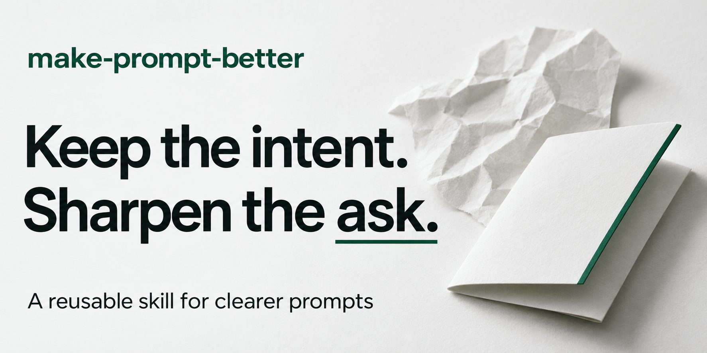

# make-prompt-better

**Turn a rough request into clear instructions, with your important details intact.**

A skill is a reusable set of instructions for your AI assistant. This one helps it rewrite prompts for writing, research, code, and everyday work. You bring the request; the skill asks your assistant to preserve your requirements and make the result easier to review.

**[Try it without installing](#try-it-without-installing)** · **[Install in your agent](#install-in-your-agent)** · **[Read the evidence](#what-the-evidence-says)**

[MIT licensed](LICENSE) · [Source code](make-prompt-better/SKILL.md) · [CI on main](https://github.com/poferraz/make-prompt-better/actions/workflows/validate-skill.yml)

## See what changes

**Your request**

> Write a friendly customer email about a one-day shipping delay. Orders will arrive Friday instead of Thursday. Apologize, stay under 100 words, and don't offer a discount.

**An illustrative rewrite**

> Write a customer email under 100 words. Use a friendly tone, apologize for the one-day shipping delay, and explain that orders will arrive Friday instead of Thursday. Include no discount offer. Return only the email.

The dates, apology, tone, length, and discount restriction all stay visible. You review the rewrite before using it. This is an editorial example; it is not a recorded model evaluation.

For code, see a [complete request, rewrite, and requirement check](docs/demo.md).

## Try it without installing

Paste this starter into your usual AI chat, followed by the request you want to improve:

```text
Rewrite the request below into a clear prompt. Keep every fact, deliverable,
constraint, and requested output order. If an essential detail is missing,
ask for it instead of inventing it. Use only as much structure as the task
needs. Return the rewritten prompt without answering the request itself.

My request:
```

This starter demonstrates the approach. Install the full skill for its task routing, reference templates, and research notes. Compare the rewrite with your original before asking your assistant to carry it out.

## Install in your agent

### Let your coding agent help

If your agent can access repositories and run local commands, paste this into it:

```text
Install make-prompt-better from https://github.com/poferraz/make-prompt-better
at release v4.4.0 for my user account in this agent. Inspect install.sh and choose this
host's --runtime option. Keep one active copy of this skill in the selected
scope, with recovery copies outside skill folders. Run the installer's
--check command, show me its result, and explain how to invoke the skill.
```

Your host may request permission to write its skill directory. [First-time setup](docs/quickstart.md) explains the steps, prerequisites, and expected result.

### Prefer the terminal?

You need Git and Bash on macOS or Linux, or in WSL on Windows. From a folder where you keep projects:

```bash
git clone --branch v4.4.0 --depth 1 https://github.com/poferraz/make-prompt-better.git
cd make-prompt-better
./install.sh --runtime codex
./install.sh --runtime codex --check
```

Replace `codex` with `claude`, `cursor`, `gemini`, `antigravity`, or `qwen`. Run `./install.sh` to update all configured targets. Node and Python are needed only for the optional developer tools below.

Codex uses one copy at `~/.agents/skills/make-prompt-better`. The installer removes older entries from the selected skill folders and keeps recovery copies outside them. Check your host's picker after installation; if Codex still shows old entries, restart it. [Update, uninstall, and recovery](docs/installation.md) · [Host compatibility](docs/compatibility.md)

**Current release:** [v4.4.0](https://github.com/poferraz/make-prompt-better/releases/tag/v4.4.0) includes these installation and onboarding improvements. npm returned 404 on 2026-11-06; use the source installation above. The npm publishing setup is configured; registry installation still awaits a published and tested package. [Maintainer setup and status](docs/npm-publishing.md).

## Use it on your next request

In Codex, type `$make-prompt-better`, select the skill, and append your request:

```text
$make-prompt-better Improve this prompt without answering it:
Compare the three proposals attached. Keep the $5,000 budget and June 30
launch date. Put a recommendation first, then a comparison table and the
questions we need to resolve. Cite the proposal for each factual claim.
```

Supply the proposals with the request. In other agents, use their skill picker or invocation syntax. You can ask for **"only the rewritten prompt"** to omit the explanation. The full skill otherwise requests a short explanation of its choices before the rewrite.

1. **Describe the work.** Include the material, intended output, constraints, and format you need.
2. **Review the rewrite.** Check names, numbers, dates, exclusions, and requested order against your original.
3. **Use the prompt.** Give the reviewed prompt to your assistant, then check the resulting work.

| Your work | What to include |
| --- | --- |
| Writing and customer communication | Audience, facts, tone, length, and what the reader should do |
| Research and comparisons | Sources, decision criteria, budget, deadline, and unknowns |
| Code and debugging | Actual code, expected behavior, error details, and tests to run |
| Agent instructions | Existing `AGENTS.md` or `CLAUDE.md`, useful commands, and project rules |

The skill selects a level of structure for the task. You do not need to learn the mode names to start. [See more examples](make-prompt-better/references/examples.md).

## What the evidence says

The workflow draws on **11 research principle groups citing 14 papers**. Its particular templates, thresholds, and routing rules are project adaptations. Requirement preservation and proportional structure are design goals informed by Zhang, Hu et al. (2026) and Ugare & Chandra (2026).

Historical v4.2.0 tests recorded **164 comparisons across 14 models**, using different evaluation protocols. The in-session track had a positive average change; the isolated cloud track had a negative one. These results do not measure the current working skill. There is no universal quality or safety guarantee.

[Results and protocol limits](research/benchmark/v4/SUMMARY_V4_ALL_MODELS.md) · [Claims register](docs/claims.md) · [Research sources](make-prompt-better/references/research-principles.md)

Use a direct prompt for a simple question or a request that is already clear. [When to use it, and when to skip it](docs/when-to-use.md).

## Questions before you start

<details>
<summary><strong>Does this answer the task or rewrite my prompt?</strong></summary>

It is primarily a prompt-rewriting skill. Say "improve this prompt without answering it" when you want a rewrite. Review that prompt before using it for the underlying task. The local CLI installs the skill or checks text patterns; it does not call a model to rewrite prompts.

</details>

<details>
<summary><strong>Do I need a subscription, an API key, or coding experience?</strong></summary>

The source is MIT licensed. The installer and linters need no API key. Your AI host has its own access requirements and may charge for usage. You can try the starter above in a chat; installing the full skill requires a host that supports skills and access to its local files.

</details>

<details>
<summary><strong>Can I install with npm or npx?</strong></summary>

Use the GitHub source commands above for now. The publishing workflow and maintainer credential are configured, but npm returned 404 on the latest check. We will add a verified npm command after the first package is published and tested. Public installation will not require a publishing token. [Distribution status](docs/npm-publishing.md).

</details>

<details>
<summary><strong>Why do I see multiple copies in Codex?</strong></summary>

Earlier installers placed backups inside skill folders and installed a second copy in `.codex/skills`. Both could appear in the picker. Run the current installer with `--runtime codex`, then `--runtime codex --check`. It keeps the current checkout's skill in `.agents/skills` and moves recognized older entries into recovery storage outside those roots. Restart Codex if the picker is stale. Separate project, admin, or plugin installations need their own review. [Troubleshooting](docs/installation.md#troubleshooting).

</details>

<details>
<summary><strong>Where does my prompt go?</strong></summary>

The installer copies local files and does not send prompts to a model. The linters read local files. When you invoke the skill, your AI host processes the prompt according to its own settings and data policy. The optional benchmark tools send test content to the endpoint you configure.

</details>

## For developers and evaluators

The optional JavaScript tools require Node.js 22+. The Python linter requires Python 3.10+. Run these from the repository:

```bash
node bin/cli.mjs lint CLAUDE.md AGENTS.md
python3 lint_context.py CLAUDE.md AGENTS.md
npm test
```

Lint findings are pattern-based review hints. Use `--fail-on-findings` if your CI should fail on them. They do not certify correctness, requirement preservation, or safety.

[Methodology](docs/methodology.md) · [Task routing](docs/task-classification.md) · [Trade-offs](docs/tradeoffs.md) · [Benchmark guide](docs/benchmark-runs.md) · [Testing](docs/testing.md)

## Help make the next prompt clearer

Try a request you already care about. If a rewrite loses a requirement or setup is confusing, [report the smallest reproducible example](SUPPORT.md), with private content removed.

[Contribute](.github/CONTRIBUTING.md) · [Report a security issue](SECURITY.md) · [Code of conduct](CODE_OF_CONDUCT.md) · [Changelog](CHANGELOG.md) · [Cite this project](CITATION.cff)
